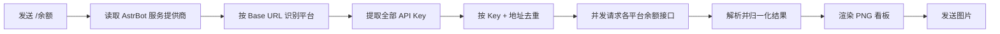

<div align="center">


# 余额看板

**自动读取 AstrBot 模型供应商，一张图看完所有平台余额**

[](https://github.com/AstrBotDevs/AstrBot)
[](CHANGELOG.md)
[](https://www.python.org/)
[](#-支持平台)
[](LICENSE)

[简体中文](README.md) · [English](README_EN.md)

</div>

> 本项目是非官方社区插件，与 DeepSeek、智谱、魔搭、Kimi、MiniMax、Ollama、302.AI、PPIO 官方均无关。  
> 插件只读取各平台公开的余额接口，不会代替你签到、充值或消耗任何额度。

---

## ✨ 功能亮点

- 🔑 **零 Key 配置**：自动读取 AstrBot「服务提供商」中已配置的 API Key 与 Base URL，
  不需要在插件设置里再填一遍，也不会额外保存一份 Key
- 🧾 **一次查全部**：AstrBot 里配置了多少个受支持的模型供应商，就查询多少个，发送一条 `/余额` 即可
- 🔁 **自动去重**：API Key 与 Base URL 相同的供应商条目只查一次、只显示一行，避免同一钱包重复出现
- 🖼 **图片结果**：查询结果渲染成简洁的 PNG 看板，大字显示平台中文名，小字标注英文名与查询地址
- 💎 **平台差异处理**：DeepSeek、智谱、Kimi、302.AI、PPIO、Ollama Cloud 显示账户余额，魔搭显示可用魔粒，MiniMax Token Plan 显示 5 小时 / 周剩余额度
- 📊 **额度窗口**：MiniMax Token Plan 与 Ollama Cloud 旧版套餐支持 5 小时 / 周剩余百分比，双窗口时在行内追加汇总行
- 🛡 **安全识别**：仅当 Base URL 指向平台官方域名时才查询，自定义 OpenAI 兼容代理会被跳过，避免把 Key 发给非预期地址
- ⚡ **并发 + 缓存 + 重试**：多账号并发请求，TTL 缓存复用结果，超时 / 429 / 5xx 自动退避重试
- 🧠 **隐私优先**：Key 只发往对应平台，消息与日志中始终脱敏
- 📱 **双平台适配**：原生支持 `aiocqhttp`（OneBot v11）与 `qq_official`（QQ 官方机器人）
- 🧩 **零外部服务**：插件直接调用各平台公开接口，不需要自建后端

## 📦 支持平台

| 平台 | 显示内容 | 余额接口 |
|---|---|---|
| [DeepSeek](https://platform.deepseek.com) | 账户余额（`¥`） | `GET /user/balance` |
| [智谱 AI](https://open.bigmodel.cn) | 账户余额（`¥`） | `GET /api/biz/account/query-customer-account-report` |
| [魔搭 ModelScope](https://modelscope.cn) | 可用魔粒 | `GET /openapi/v1/magicubes/balance` |
| [Kimi](https://platform.moonshot.cn) | 账户余额（国内站 `¥` / 国际站 `$`） | `GET /v1/users/me/balance` |
| [MiniMax Token Plan](https://platform.minimaxi.com) | 5h / 周剩余额度（`%`） | `GET /v1/token_plan/remains` |
| [Ollama Cloud](https://ollama.com) | 账户余额（`$`）/ 旧版 5h、周剩余额度 | `GET /api/balance` |
| [302.AI](https://302.ai) | 账户余额（`$`） | `GET /dashboard/balance` |
| [PPIO](https://ppio.com) | 账户余额（`¥`） | `GET /openapi/v1/billing/balance/detail` |

| 消息平台 | 适配器 | 状态 |
|---|---|---|
| OneBot v11 | `aiocqhttp` | ✅ 已支持 |
| QQ 官方机器人 | `qq_official` | ✅ 已支持 |

> 插件只发送图片（渲染失败时回退为纯文本），不依赖 Markdown、按钮或平台专属消息段，因此两个消息平台的行为一致。

## 🚀 安装

### 方式一：插件市场（推荐）

在 AstrBot 管理面板 → **插件** → **插件市场**，搜索 **“余额看板”** 并安装。

### 方式二：手动安装

```bash
cd AstrBot/data/plugins
git clone https://github.com/HoshimiSenya/astrbot_plugin_balance_board
pip install -r astrbot_plugin_balance_board/requirements.txt
```

重启 AstrBot，然后在管理面板启用插件。

> 插件要求 **AstrBot 4.5 及以上（4.x 系列）**。插件通过 `metadata.yaml` 自动注册，无需使用已弃用的 `@register` 装饰器。  
> 图片渲染依赖 Pillow，`requirements.txt` 已包含；若你的环境已安装 AstrBot，通常也已自带 Pillow。

## 🔌 在 AstrBot 中配置平台

插件不保存任何 Key，所有 Key 都来自 AstrBot 的 **服务提供商（模型供应商）** 配置：

1. 打开 AstrBot 管理面板 → **服务提供商** → 新建。
2. 选择平台（DeepSeek / 智谱 / 魔搭 / Kimi / MiniMax / Ollama / 302.AI / PPIO）或 OpenAI 兼容方式，填写 API Key。
3. 保存后回到聊天，发送 `/余额`。

| 平台 | 控制台 | 备注 |
|---|---|---|
| DeepSeek | <https://platform.deepseek.com/api_keys> | 形如 `sk-...`，Base URL 通常为 `https://api.deepseek.com` 或 `.../v1` |
| 智谱 AI | <https://open.bigmodel.cn/usercenter/apikeys> | Base URL 通常为 `https://open.bigmodel.cn/api/paas/v4` |
| 魔搭 ModelScope | <https://modelscope.cn/my/myaccesstoken> | 访问令牌形如 `ms-...`；聊天地址可填 `https://api-inference.modelscope.cn/v1` |
| Kimi | <https://platform.moonshot.cn/console/api-keys> | Base URL 通常为 `https://api.moonshot.cn/v1`；国际站可用 `https://api.moonshot.ai/v1` |
| MiniMax Token Plan | <https://platform.minimaxi.com/console/plan> | 仅支持订阅版 Token Plan（`sk-cp-...`），不支持普通按量付费余额；Base URL 通常为 `https://api.minimaxi.com/anthropic` |
| Ollama Cloud | <https://ollama.com/settings/keys> | 仅识别 `ollama.com` 云端地址；本地 `127.0.0.1:11434` 会被跳过 |
| 302.AI | <https://302.ai> | Base URL 通常为 `https://api.302.ai/v1` |
| PPIO | <https://ppio.com> | Base URL 可为 `https://api.ppinfra.com/v3/openai` 或 `https://api.ppio.com/openai` |

> ⚠️ 各平台 Key 互不通用。请按平台分别添加供应商，不要把 A 平台的 Key 填到 B 平台的条目里。

## 🧭 自动识别规则

插件优先按 Base URL 的主机名识别平台：

| Base URL 包含 | 识别为 | 看板显示 |
|---|---|---|
| `deepseek.com` | DeepSeek | 大字 `DeepSeek`，小字 `DeepSeek · 查询地址` |
| `bigmodel.cn` / `zhipuai.cn` | 智谱 AI | 大字 `智谱`，小字 `Zhipu AI · 查询地址` |
| `modelscope.cn` / `modelscope.ai` | 魔搭 ModelScope | 大字 `魔搭`，小字 `ModelScope · www.modelscope.cn` |
| `moonshot.cn` / `moonshot.ai` / `kimi.com` / `kimi.ai` | Kimi | 大字 `Kimi`，小字 `Kimi / Moonshot · 查询地址` |
| MiniMax Token Plan 类型 / ID + `minimax.io` / `minimaxi.com` / `minimax.cn` | MiniMax Token Plan | 大字 `MiniMax`，小字 `Token Plan · 查询地址` |
| `ollama.com` | Ollama Cloud | 大字 `Ollama`，小字 `Ollama Cloud · ollama.com` |
| `302.ai` / `302ai.com` | 302.AI | 大字 `302.AI`，小字 `302.AI · 查询地址` |
| `ppio.com` / `ppinfra.com` | PPIO | 大字 `PPIO`，小字 `PPIO · api.ppio.com` |

- 供应商没有填写 Base URL 时，会根据供应商类型 / ID 中的关键字（如 `deepseek`、`zhipu`、`modelscope`、`kimi`、`302ai`、`ppio`）判断。
- MiniMax 只有在供应商类型 / ID 明确包含 `token_plan` / `token-plan` 时才会识别为 Token Plan；普通 MiniMax 按量付费供应商会被跳过。
- Ollama 只识别云端 `ollama.com`；本地 Ollama（`127.0.0.1:11434`）没有对应余额接口，会被跳过。
- **自定义 OpenAI 兼容代理**（例如指向 `https://proxy.example.com/v1`）不会自动查询：
  这类地址无法确定余额接口，且把 Key 发往官方域名也不安全，插件会跳过它并在日志中说明。
- 不支持的平台（OpenAI、Gemini、本地 Ollama 等）会被静默跳过，不影响其他平台的查询。

## 💬 使用

AstrBot 默认命令前缀是 `/`，如果你修改过唤醒前缀，请以实际配置为准。命令默认**仅管理员可用**。

| 命令 | 别名 | 说明 |
|---|---|---|
| `/余额` | `/余额查询`、`/查余额`、`/模型余额`、`/余额看板`、`/balance` | 自动读取所有受支持的模型供应商并输出图片看板 |

命令执行时会重新读取 AstrBot 的供应商列表，因此新增或删除供应商后**无需重载插件**，直接再次查询即可。

### 渲染效果

<div align="center">


</div>

- 每一行对应一个「钱包」：左侧色条代表平台，大字是平台中文名，小字是英文名与查询地址。
- 金额右对齐；魔搭行显示 **可用魔粒**，其余平台显示 **余额**；MiniMax Token Plan 与 Ollama Cloud 旧版套餐显示 **5h 剩余** 或 **周剩余** 百分比。
- 同时存在 5 小时和周额度时，行下方会追加一行 `5h: 75% · 周: 40%` 汇总。
- 同一平台有多个不同 Key 时会自动编号为 `#1`、`#2`。
- 查询失败的账号会以红色「查询失败」显示在图片中，并附上简短原因，不影响其他账号。
- 图片渲染失败时会自动回退为纯文本结果。

## ⚙️ 插件配置

在 AstrBot 管理面板 → 插件 → **余额看板** → 配置。这里**没有 API Key 选项**，只需按需调整查询行为：

| 配置项 | 默认值 | 说明 |
|---|---|---|
| `cache_ttl` | `60` | 查询缓存时间（秒），`0` 表示关闭 |
| `user_cooldown` | `5` | 单用户查询冷却（秒），`0` 表示关闭 |
| `request_timeout` | `10` | 单个平台请求超时（秒） |
| `proxy` | 空 | 可选 HTTP 代理，例如 `http://127.0.0.1:7890` |
| `max_retries` | `2` | 超时 / 429 / 5xx 的最大重试次数（鉴权失败不重试） |

### 去重规则

- 判断依据是 **API Key + 实际查询地址**，与供应商名称、模型名称无关：
  同一个 Key 在多个供应商条目中重复出现、或 Base URL 只差 `/v1` 等路径，都只会查询并显示一次。
- 同一供应商配置了多个 Key 时，每个 Key 都会查询；完全相同的 Key 会自动去重。
- 同一个 Key 对应不同查询主机时会被视为两个账号。
- 最多查询 30 个账号，超出的条目会被忽略并写入日志。

## 🔍 工作原理



| 平台 | 读取字段 |
|---|---|
| DeepSeek | `balance_infos[].total_balance`（优先 `CNY`） |
| 智谱 AI | `data.availableBalance`，回退 `balance` / `availBalance` |
| 魔搭 ModelScope | `data.available_balance` |
| Kimi | `data.available_balance`，回退 `balance` / `available` |
| MiniMax Token Plan | `model_remains[].current_interval_remaining_percent` / `current_weekly_remaining_percent` |
| Ollama Cloud | `included.balance_usd` + `purchased.balance_usd`；旧版 `included.session` / `included.weekly` 的 `remaining_percent` |
| 302.AI | `data.balance`，回退 `available_balance` |
| PPIO | `availableBalance`（单位 1/10000 元，自动换算为 `¥`） |

- Kimi 余额接口不返回币种，国内站按 `¥`、国际站按 `$` 显示。
- 同一账号在 `cache_ttl` 内复用结果，避免频繁请求平台接口。
- 鉴权失败不会重试；超时、429 和 5xx 会按指数退避重试。
- 所有 Key 在展示前都会脱敏，例如 `sk-0123…cdef`。

## 🛡 安全与隐私

- **自动读取、不复制 Key**：插件直接读取 AstrBot 服务提供商配置，不新增 Key 副本。
- **限制发送目标**：只有当 Base URL 指向受支持平台的官方域名时才会发起余额查询；
  自定义代理、未适配平台不会收到请求。
- **不落地用户数据**：插件不保存账号绑定关系，也不会把 Key 写入自己的配置文件。
- **日志脱敏**：错误信息与日志中的 Key 都会隐藏中间部分。
- **配置文件是明文**：Key 仍保存在 AstrBot 的提供商配置中，请限制数据目录的访问权限。
- **建议使用专用 Key**：如果 Key 可能泄露，请立即到对应平台吊销并重新生成。

> 请不要把插件配置或包含完整 Key 的日志提交到 GitHub / 发到群里。

## 📱 QQ 官方机器人注意事项

- QQ 官方机器人对被动回复有时限要求。如果服务器访问平台接口较慢，可适当调整 `request_timeout`。
- 图片发送依赖 AstrBot 的图片消息能力；若图片发送失败，插件会回退为纯文本。
- 如果希望限制使用范围，命令默认已设置为仅管理员，可在 AstrBot 的指令管理中进一步调整。

## ❓ 常见问题

<details>
<summary><b>提示“未在 AstrBot 的模型供应商中找到可查询余额的配置”</b></summary>

请先在 AstrBot 管理面板 → **服务提供商** 中添加 DeepSeek、智谱 AI、魔搭 ModelScope、
Kimi、MiniMax Token Plan、Ollama Cloud、302.AI 或 PPIO 的供应商并填写 API Key。
插件只识别上方「支持平台」表中的平台。
</details>

<details>
<summary><b>为什么图片里只有部分供应商？</b></summary>

- 未适配的平台（OpenAI、Gemini、本地 Ollama 等）会被跳过。
- 指向自定义代理地址的供应商会被跳过，插件只查询官方域名的余额接口。
- 多个供应商使用同一个 Key 与查询地址时会被自动去重。
- 可以在 AstrBot 日志中查看“已跳过无法识别余额接口的供应商”等提示。
</details>

<details>
<summary><b>为什么同一个平台只显示一个账号？</b></summary>

插件会按 **API Key + 实际查询地址** 去重。请在 AstrBot 服务提供商中确认这些条目的
Key 是否相同；如果确实使用同一个 Key，它们本来就对应同一个钱包，不应重复显示。
</details>

<details>
<summary><b>返回 401 / “API Key 无效或无权访问”</b></summary>

- 检查 AstrBot 服务提供商中的 Key 是否完整、是否包含多余空格。
- 检查 Key 是否属于当前平台：不同平台的 Key 不能混用。
- 到对应平台控制台确认 Key 未被吊销，必要时重新生成后更新供应商配置。
</details>

<details>
<summary><b>魔搭为什么显示的是魔粒？</b></summary>

魔搭社区的额度单位是魔粒，插件显示可用魔粒；其他平台显示账户余额。
</details>

<details>
<summary><b>为什么 MiniMax 没有显示？</b></summary>

插件只支持 MiniMax **Token Plan** 订阅额度，不查询普通按量付费账户余额。请在 AstrBot 中
添加类型 / ID 包含 `token_plan` 或 `token-plan` 的 MiniMax Token Plan 供应商，并使用
订阅 Key（通常以 `sk-cp-` 开头）。普通 MiniMax 供应商会被安全跳过。
</details>

<details>
<summary><b>为什么 Ollama 没有显示？</b></summary>

插件只查询 Ollama **Cloud**（`ollama.com`）的余额。本地 Ollama 服务没有余额接口，
指向 `127.0.0.1:11434` 的供应商会被跳过。使用云端模型时，请把 Base URL 配置为
`https://ollama.com/v1` 并填写 Ollama Cloud API Key。
</details>

<details>
<summary><b>图片没有发出来怎么办？</b></summary>

先查看 AstrBot 日志中是否有渲染或上传失败的信息。插件在渲染失败时会自动发送纯文本结果；
若仍然收不到消息，请检查 Pillow 是否已安装、服务器字体是否可用，以及适配器的图片发送权限。
</details>

## 🧑‍💻 开发

```bash
git clone https://github.com/HoshimiSenya/astrbot_plugin_balance_board
cd astrbot_plugin_balance_board

python -m venv .venv
# Windows: .venv\Scripts\activate
# Linux/macOS: source .venv/bin/activate

pip install -r requirements-dev.txt

# 单元测试（不需要安装 AstrBot）
python -m unittest discover -s tests -v

# 代码检查
ruff check .
ruff format --check .
```

### 目录结构

```text
astrbot_plugin_balance_board/
├── main.py                 # AstrBot 插件入口、供应商发现与并发查询
├── src/
│   ├── accounts.py         # 从 AstrBot 供应商中提取 Key、地址归一化与去重
│   ├── cache.py            # 内存 TTL 缓存
│   ├── client.py           # 统一 HTTP 客户端、重试与错误映射
│   ├── constants.py        # 插件常量
│   ├── errors.py           # 用户可读的错误类型
│   ├── format.py           # 纯文本回退结果
│   ├── models.py           # 查询结果模型
│   ├── providers.py        # 平台识别、接口定义与响应解析
│   ├── render.py           # Pillow 图片渲染
│   └── security.py         # Key 校验、脱敏与日志清洗
├── tests/                  # 单元测试
├── docs/preview.png        # 渲染示例
├── _conf_schema.json       # AstrBot 配置 Schema
├── metadata.yaml           # 插件元数据
├── requirements.txt
├── README.md
├── README_EN.md
├── CHANGELOG.md
├── CONTRIBUTING.md
├── SECURITY.md
└── LICENSE
```

### 发布新版本

1. 更新 `metadata.yaml` 与 `src/constants.py` 中的版本号。
2. 更新 `CHANGELOG.md`。
3. 提交并打标签：
   ```bash
   git tag v1.1.0
   git push origin main --tags
   ```
4. GitHub Actions 会自动创建 Release。

## 🤝 贡献

欢迎提交 Issue 和 Pull Request。请先阅读 [CONTRIBUTING.md](CONTRIBUTING.md)。

安全问题请按 [SECURITY.md](SECURITY.md) 中的方式私下报告，不要在公开 Issue 中粘贴 API Key。

## 📄 许可证

本项目采用 [MIT License](LICENSE) 开源。

## ⚠️ 免责声明

- 本项目为社区非官方项目，与各平台官方无关。
- 各平台 OpenAPI 可能随时调整，若接口变更导致插件失效，欢迎提交 Issue。
- 请遵守各平台的服务条款与所在平台的使用规范，不要高频请求或滥用接口。