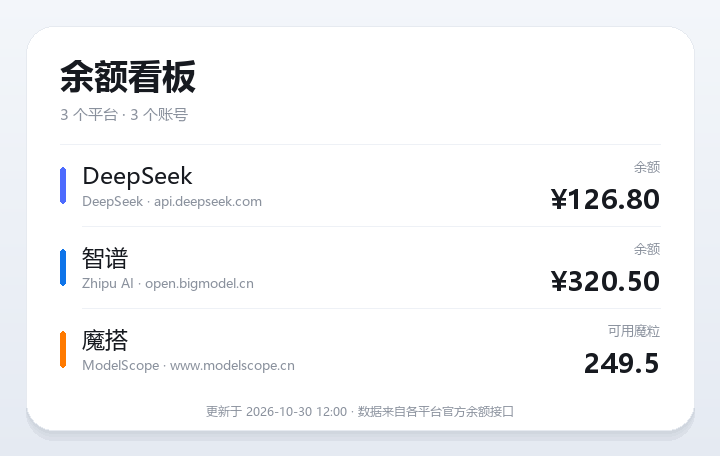

<div align="center">


# Balance Board

**Reads AstrBot's model providers automatically — every balance in one clean image**

[](https://github.com/AstrBotDevs/AstrBot)
[](CHANGELOG.md)
[](https://www.python.org/)
[](LICENSE)

[简体中文](README.md) · English



</div>

> Unofficial community plugin, not affiliated with DeepSeek, Zhipu AI or ModelScope.  
> The plugin only reads balance data; it never checks in, tops up or spends any credits.

## Features

- 🔑 **No keys in the plugin**: API keys and base URLs are read directly from AstrBot's configured model providers
- 🧾 **All providers at once**: every supported provider configured in AstrBot is queried with one `/余额` command
- 🔁 **Automatic de-duplication**: provider entries sharing the same API key and balance endpoint are queried once and shown once
- 🖼 **Image output**: results are rendered as a clean PNG card — the big text shows the platform's Chinese name, the small line shows its English name and balance endpoint
- 💎 **Provider-aware units**: DeepSeek and Zhipu AI show account balance, ModelScope shows available magicubes
- 🛡 **Safe matching**: keys are only sent when the base URL points at a supported provider's official host; custom OpenAI-compatible proxies are skipped
- ⚡ **Concurrency, cache and retries**: providers are queried concurrently, successes are cached with a TTL, and timeouts / 429 / 5xx are retried with backoff
- 🧠 **Privacy first**: keys are only sent to their own provider and are masked in messages and logs
- 📱 **Two adapters**: `aiocqhttp` (OneBot v11) and `qq_official` (QQ official bot)
- 🧩 **No backend**: the plugin calls the provider APIs directly

## Supported providers

| Provider | Displayed | Endpoint |
|---|---|---|
| [DeepSeek](https://platform.deepseek.com) | Account balance (`¥`) | `GET /user/balance` |
| [Zhipu AI](https://open.bigmodel.cn) | Account balance (`¥`) | `GET /api/biz/account/query-customer-account-report` |
| [ModelScope](https://modelscope.cn) | Available magicubes (魔粒) | `GET /openapi/v1/magicubes/balance` |

| Messaging platform | Adapter | Status |
|---|---|---|
| OneBot v11 | `aiocqhttp` | ✅ Supported |
| QQ official bot | `qq_official` | ✅ Supported |

> The plugin sends an image (falling back to plain text if rendering fails) and uses no Markdown, buttons or platform-specific message segments, so both adapters behave identically.

## Install

### Plugin marketplace

Search for **“余额看板”** in the AstrBot plugin marketplace.

### Manual

```bash
cd AstrBot/data/plugins
git clone https://github.com/HoshimiSenya/astrbot_plugin_balance_board
pip install -r astrbot_plugin_balance_board/requirements.txt
```

Restart AstrBot and enable the plugin.

> Requires **AstrBot 4.5+ (4.x series)**. Registration is handled automatically via `metadata.yaml`; the deprecated `@register` decorator is not used.  
> Image rendering uses Pillow, already listed in `requirements.txt`.

## Configure providers in AstrBot

The plugin stores no keys. Everything comes from AstrBot's **service providers**:

1. Open the AstrBot admin panel → **Providers** → **Add provider**.
2. Pick a platform (DeepSeek / Zhipu / ModelScope) or an OpenAI-compatible provider, then enter the API key.
3. Save and send `/余额` in chat.

| Provider | Console | Notes |
|---|---|---|
| DeepSeek | <https://platform.deepseek.com/api_keys> | Keys look like `sk-...`; base URL is usually `https://api.deepseek.com` or `.../v1` |
| Zhipu AI | <https://open.bigmodel.cn/usercenter/apikeys> | Base URL is usually `https://open.bigmodel.cn/api/paas/v4` |
| ModelScope | <https://modelscope.cn/my/myaccesstoken> | Tokens look like `ms-...`; chat base can be `https://api-inference.modelscope.cn/v1` |

> ⚠️ Keys are provider-specific. Add one provider per platform and do not paste a key into another provider's entry.

## Detection rules

The plugin identifies the balance platform from the base URL host:

| Base URL contains | Detected as | Card display |
|---|---|---|
| `deepseek.com` | DeepSeek | Big text `DeepSeek`, small line `DeepSeek · endpoint` |
| `bigmodel.cn` / `zhipuai.cn` | Zhipu AI | Big text `智谱`, small line `Zhipu AI · endpoint` |
| `modelscope.cn` / `modelscope.ai` | ModelScope | Big text `魔搭`, small line `ModelScope · www.modelscope.cn` |

- When a provider has no base URL, the provider type/id keywords (`deepseek`, `zhipu`, `modelscope`, …) are used as a hint.
- **Custom OpenAI-compatible proxies** (e.g. `https://proxy.example.com/v1`) are skipped on purpose: their balance endpoint is unknown and sending the key to an official host would be unsafe.
- Unsupported platforms (OpenAI, Gemini, Ollama, …) are skipped silently and never affect other providers.

## Commands

The default AstrBot command prefix is `/`. Commands are **admin-only** by default.

| Command | Aliases | Description |
|---|---|---|
| `/余额` | `/余额查询`, `/查余额`, `/模型余额`, `/余额看板`, `/balance` | Query every supported provider and send the rendered board |

The provider list is re-read on every query, so newly added or removed providers take effect immediately without reloading the plugin.

### Output

<div align="center"></div>

- One row per wallet: the coloured bar marks the provider, the big text is its Chinese name, and the small line shows the English name and balance host.
- Amounts are right-aligned; ModelScope rows show **available magicubes**, every other row shows **balance**.
- Multiple distinct keys on one platform are numbered `#1`, `#2`.
- Failed accounts are shown in red with a short reason and do not affect the other rows.
- If rendering fails, the plugin falls back to a plain-text card.

## Plugin configuration

AstrBot admin panel → Plugins → **余额看板** → Config. There is **no API key field** — only query behaviour:

| Key | Default | Description |
|---|---|---|
| `cache_ttl` | `60` | Cache TTL in seconds; `0` disables the cache |
| `user_cooldown` | `5` | Per-user cooldown in seconds; `0` disables it |
| `request_timeout` | `10` | Per-request timeout in seconds |
| `proxy` | empty | Optional HTTP proxy, e.g. `http://127.0.0.1:7890` |
| `max_retries` | `2` | Retries for timeout / 429 / 5xx; authentication failures are never retried |

### De-duplication rules

- Identity is **API key + balance endpoint**. Provider names and model names are ignored.
- The same key appearing in several provider entries, or base URLs that differ only by `/v1`-style paths, count as one wallet.
- Every distinct key of a provider is queried; identical keys are collapsed.
- The same key on different balance hosts is treated as two accounts.
- At most 30 accounts are queried; extra entries are ignored and logged.

## How it works

```mermaid
flowchart LR
    A[/余额] --> B[Read AstrBot providers]
    B --> C[Detect platform by base URL]
    C --> D[Collect API keys]
    D --> E[Deduplicate by key + endpoint]
    E --> F[Query balance endpoints concurrently]
    F --> G[Parse results]
    G --> H[Render PNG board]
    H --> I[Send image]
```

| Provider | Parsed fields |
|---|---|
| DeepSeek | `balance_infos[].total_balance` (prefers `CNY`) |
| Zhipu AI | `data.availableBalance`, falling back to `balance` / `availBalance` |
| ModelScope | `data.available_balance` |

- Successes are reused within `cache_ttl`.
- Authentication failures are not retried; timeouts, 429 and 5xx use exponential backoff.
- Keys are masked before being shown, e.g. `sk-0123…cdef`.

## Security

- Keys are read from AstrBot's provider configuration; the plugin does not create or store a second copy.
- Requests are only made to supported providers' official hosts. Custom proxies and unsupported platforms are never contacted.
- No user data is stored.
- Keys are masked in every message and log line.
- Keys are stored as plain text in AstrBot's provider configuration. Restrict access to the data directory.
- Rotate a key immediately if it leaks.

## QQ official bot notes

- QQ official bots have a reply deadline. Increase `request_timeout` if provider APIs are slow.
- Image delivery depends on AstrBot's image support; the plugin falls back to plain text on failure.
- Commands are admin-only by default; adjust further in AstrBot's command management if needed.

## FAQ

<details>
<summary><b>“未在 AstrBot 的模型供应商中找到可查询余额的配置”</b></summary>

Add a DeepSeek, Zhipu AI or ModelScope provider in AstrBot's **Providers** page with an API
key. Only these three platforms are supported.
</details>

<details>
<summary><b>Why are only some providers shown?</b></summary>

- Unsupported platforms (OpenAI, Gemini, Ollama, …) are skipped.
- Providers pointing at custom proxy hosts are skipped on purpose.
- Providers sharing the same key and endpoint are de-duplicated.
- Check the AstrBot log for the “skipped providers without a recognized balance endpoint” message.
</details>

<details>
<summary><b>Why does one platform show only one account?</b></summary>

Accounts are de-duplicated by **API key + balance endpoint**. If two provider entries use the
same key, they refer to the same wallet and are shown once.
</details>

<details>
<summary><b>HTTP 401 / invalid API key</b></summary>

- Check that the key in AstrBot's provider configuration is complete and has no surrounding spaces.
- Check that the key belongs to the configured platform.
- Confirm the key is still active in the provider console, then update the provider.
</details>

<details>
<summary><b>Why does ModelScope show magicubes?</b></summary>

ModelScope credits are called magicubes (魔粒), so the card shows available magicubes; other
platforms show the account balance.
</details>

<details>
<summary><b>The image is not delivered</b></summary>

Check the AstrBot logs for rendering or upload errors. The plugin falls back to plain text when
rendering fails; also verify that Pillow and a CJK font are available on the server.
</details>

## Development

```bash
python -m venv .venv
pip install -r requirements-dev.txt

python -m unittest discover -s tests -v
ruff check .
ruff format --check .
```

The test suite does not require AstrBot to be installed.

### Layout

```text
main.py             AstrBot entry point, provider discovery and concurrent queries
src/accounts.py     Provider discovery, key extraction, endpoint normalisation, dedupe
src/client.py       Shared HTTP client, retries and error mapping
src/providers.py    Provider detection, specs and response parsers
src/render.py       Pillow image rendering
src/format.py       Plain-text fallback
src/security.py     Key validation and masking
tests/              Standard-library unittest suite
```

## License

[MIT](LICENSE)

## Disclaimer

This is an unofficial community project. Providers may change their APIs at any time.
Please follow each provider's terms of service and avoid excessive requests.